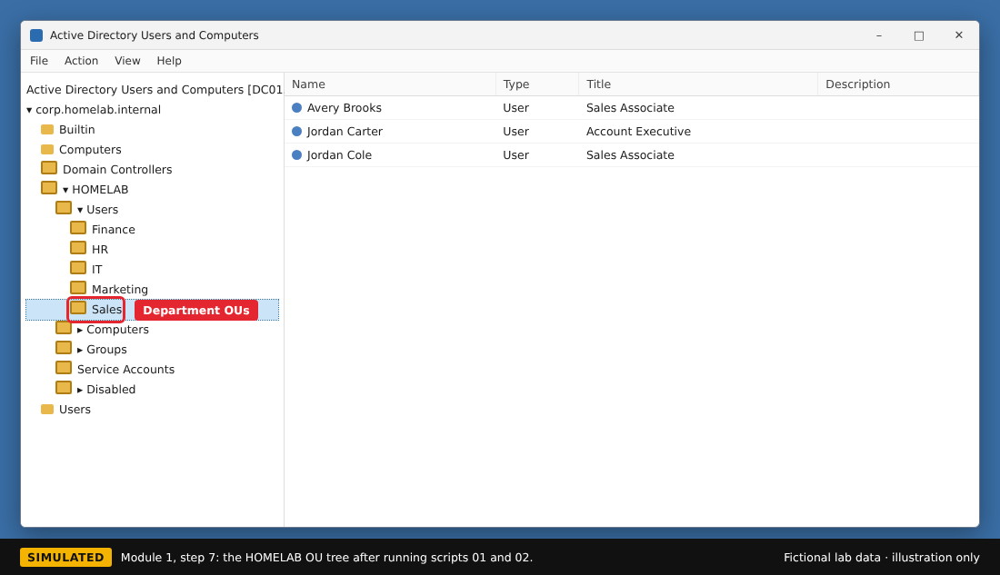

# Active Directory for Help Desk: A Hands-On Walkthrough


> **This is a walkthrough.** Follow it in order, step by step, in your own home lab. Every module tells you what to do, why you're doing it, and how to check that it worked. It is free for anyone to use, copy, teach from and adapt (see [LICENSE](LICENSE)).

A free, self-paced lab that teaches the Active Directory skills help desk and IT support technicians use every day: account lockouts, password resets, onboarding and offboarding, group membership, Group Policy, and keeping the directory clean.

You build a small company network on your own PC, then work through realistic support tickets in it. By the end you'll have hands-on experience you can talk about in interviews, plus a GitHub portfolio of your own work.



---

## How to use this walkthrough

1. **Go in order.** Each module builds on the one before it. Start at [Module 1](docs/01-lab-setup.md) and tick your way through the **[step-by-step checklist](CHECKLIST.md)**.
2. **Compare with the pictures.** Key steps include a simulated screenshot of what your screen should look like, with red callouts on the parts that matter. They use fictional lab data only.
3. **Do it by hand first, then script it.** Each task is shown in the GUI (ADUC, GPMC) and in PowerShell. Doing both is how it sticks.
4. **Break things on purpose.** The [exercises](exercises/README.md) set up a real problem in your lab, then you work it like a ticket.
5. **Write it down.** Fill in the [ticket notes template](exercises/TEMPLATE.md) as you go. Clear notes are half of a help desk job.
6. **Check, don't copy.** Look at the [solutions](solutions/README.md) only after you've tried. If a term is new, look it up in the [glossary](GLOSSARY.md).
7. **Want the overview first?** Flip through the [13-slide presentation](presentation/AD-Help-Desk-Walkthrough.pdf).

---

## Who this is for

- People preparing for a first help desk / IT support job
- CompTIA A+ or Network+ students who want hands-on Windows Server practice
- Anyone who has heard "Active Directory" in job postings and wants to actually use it

**Prerequisites:** comfortable installing Windows and using File Explorer. No PowerShell or server experience needed.

## What you'll be able to do

By the end of the walkthrough you will be able to:

1. Install Windows Server, promote it to a Domain Controller, and join a Windows 11 PC to the domain
2. Design an OU and group structure and explain why it's organized that way
3. Create, reset, unlock, disable and move user accounts with both the GUI (ADUC) and PowerShell
4. Find what's causing repeated account lockouts using the Security event log
5. Grant access with security groups following least privilege
6. Create and troubleshoot Group Policy with `gpupdate` and `gpresult`
7. Fix a broken computer-to-domain trust relationship
8. Write clear ticket notes: problem, troubleshooting, root cause, resolution

---

## Course path

| Module | What you do | Time |
| --- | --- | --- |
| 1. Build the lab | [docs/01-lab-setup.md](docs/01-lab-setup.md) | 2–3 hrs |
| 2. Structure the directory | [docs/02-ou-design.md](docs/02-ou-design.md), run scripts 01–02 | 1 hr |
| 3. Group Policy | [docs/03-group-policy.md](docs/03-group-policy.md) | 1–2 hrs |
| 4. Learn the procedures | [docs/04-helpdesk-runbook.md](docs/04-helpdesk-runbook.md) | 1 hr |
| 5. Work the tickets | [exercises/](exercises/README.md) (check against [solutions/](solutions/README.md) **after** you try) | 2–4 hrs |
| 6. Publish your portfolio | [Turn your work into a portfolio](#turn-your-work-into-a-portfolio) | 1 hr |

Suggested pace: one weekend, or one module per evening for a week.

---

## Lab environment

| VM | OS | Role | vCPU / RAM |
| --- | --- | --- | --- |
| DC01 | Windows Server 2022 (180-day evaluation) | Domain Controller, DNS | 2 / 4 GB |
| CLIENT01 | Windows 11 Enterprise (90-day evaluation) | Domain workstation | 2 / 4 GB |

You need a PC with 16 GB RAM (8 GB works with 3 GB per VM) and ~100 GB free disk.

---

## Repository layout

```
ad-helpdesk-walkthrough/
├── docs/                 # Step-by-step modules
├── scripts/              # PowerShell tools you'll run on DC01 (read them, they're commented)
├── data/new-hires.csv    # Sample onboarding data (fictional people)
├── exercises/            # Support tickets to solve in your lab
├── solutions/            # Model answers. Try the exercise first!
├── images/               # Simulated screenshots of key steps (fictional data)
├── screenshots/          # Evidence checklist: what to capture in YOUR lab
├── CHECKLIST.md          # Step-by-step instruction list for the whole walkthrough
├── presentation/         # Slide deck (PDF) introducing the walkthrough
├── GLOSSARY.md           # Plain-English definitions of every AD term used here
├── INSTRUCTOR.md         # For anyone running this as a class or study group
└── LICENSE               # MIT: free to use, share and adapt
```

---

## Running the scripts

On DC01, in an elevated PowerShell window:

```powershell
Set-ExecutionPolicy RemoteSigned -Scope CurrentUser   # one time
cd C:\Lab\ad-helpdesk-walkthrough\scripts

.\01-Build-OUStructure.ps1 -WhatIf     # preview first
.\01-Build-OUStructure.ps1
```

Every script that changes data supports `-WhatIf`. Get in the habit of using it: in a real job, previewing a change before making it is what separates careful techs from the ones who cause outages.

**Learning tip:** for each script, do the task once by hand in ADUC first, *then* run the script. You'll understand what it's automating, and you'll be able to answer interview questions about both.

---

## Turn your work into a portfolio

When you've finished the walkthrough:

1. **Fork** this repo (or create your own) on GitHub.
2. Fill in [`exercises/TEMPLATE.md`](exercises/TEMPLATE.md) for each ticket **with what you actually saw**: your commands, your errors, your fixes.
3. Add your screenshots to `screenshots/` using the checklist there.
4. Add a **"What I learned"** section to your README in your own words. Mention what broke and how you fixed it. Hiring managers care more about that than a perfect run.

> Don't copy the model solutions into your portfolio as your own work. Interviewers ask follow-up questions, and your own notes (mistakes included) are what let you answer them.

---

## Going further

- [ ] Add a second DC and practice replication troubleshooting (`repadmin /replsummary`)
- [ ] Set up DHCP on DC01 with a scope and reservations
- [ ] Build a file server with NTFS + share permissions by department group
- [ ] Enable the AD Recycle Bin and restore a deleted user
- [ ] Connect to Microsoft Entra ID with Entra Connect in a trial tenant
- [ ] Install a ticketing system (e.g. osTicket) and log your lab tickets in it

---

## Use it, share it, improve it

This walkthrough is released under the [MIT License](LICENSE). You're free to use it on your own, teach a class with it, fork it, translate it, or build on it. Found a mistake or have a better way to explain something? Open an issue or a pull request.

---

*All names in this lab are fictional. Built for learning; don't run these scripts against a production domain without review.*
