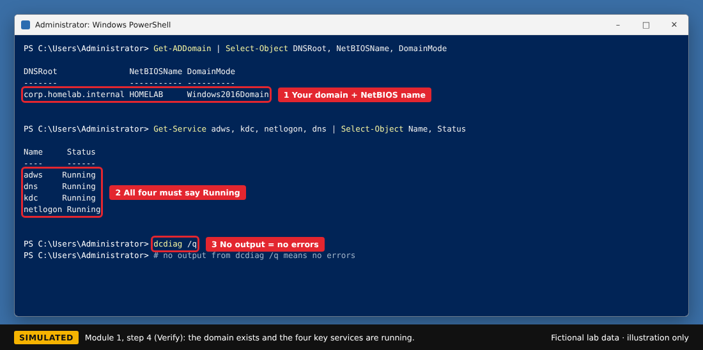
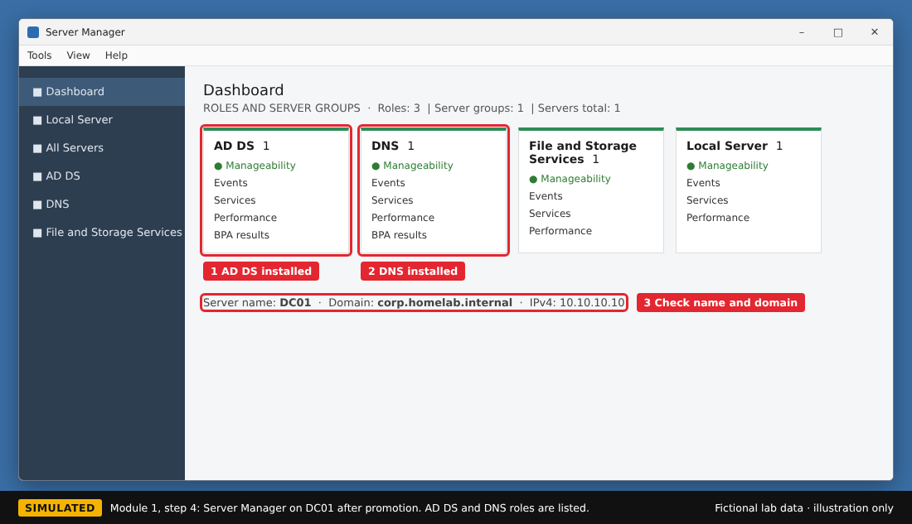
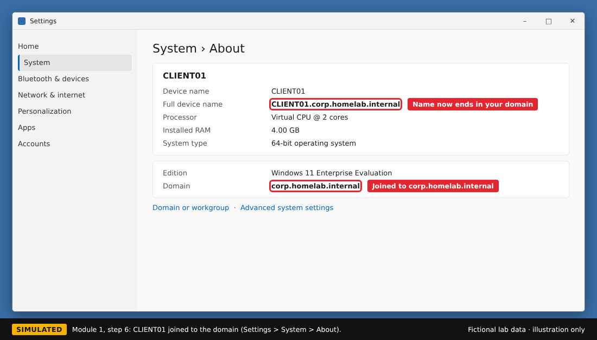
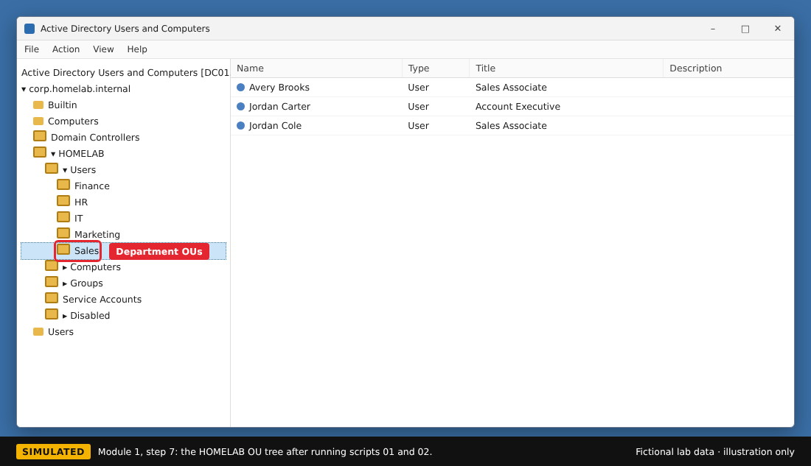

# 01 – Building the Lab

This guide builds a two-VM Active Directory lab from nothing. Budget about 2–3 hours the first time.

## Requirements

- A PC with 16 GB RAM (8 GB works if you give each VM 3 GB), virtualization enabled in BIOS, ~100 GB free disk
- Hypervisor: **Hyper-V** (built into Windows 10/11 Pro) or **VirtualBox** (free, any edition)
- ISOs (free evaluation versions from the Microsoft Evaluation Center):
  - Windows Server 2022 – 180-day evaluation
  - Windows 11 Enterprise – 90-day evaluation

> Tip: take a VM **checkpoint/snapshot** after each numbered section below so you can roll back.

---

## 1. Create the network

Both VMs must be on the same network and able to reach each other.

- **Hyper-V:** Virtual Switch Manager → New → *Internal* switch named `LabNet`
- **VirtualBox:** File → Tools → Network Manager → NAT Networks → create `LabNet` with `10.10.10.0/24`

## 2. Install Windows Server 2022 (DC01)

1. New VM: 2 vCPU, 4 GB RAM, 60 GB disk, attached to `LabNet`, boot from the Server ISO.
2. Choose **Windows Server 2022 Standard Evaluation (Desktop Experience)**.
3. Set the local Administrator password.

## 3. Configure DC01 basics

Run in an elevated PowerShell on DC01:

```powershell
# Rename the server (reboots)
Rename-Computer -NewName "DC01" -Restart

# After reboot: static IP. A DC must never use DHCP.
$nic = (Get-NetAdapter | Where-Object Status -eq 'Up' | Select-Object -First 1).Name
New-NetIPAddress -InterfaceAlias $nic -IPAddress 10.10.10.10 -PrefixLength 24 -DefaultGateway 10.10.10.1
Set-DnsClientServerAddress -InterfaceAlias $nic -ServerAddresses 127.0.0.1
```

## 4. Install AD DS and promote to Domain Controller

```powershell
Install-WindowsFeature AD-Domain-Services -IncludeManagementTools

Install-ADDSForest `
    -DomainName "corp.homelab.internal" `
    -DomainNetbiosName "HOMELAB" `
    -InstallDns `
    -SafeModeAdministratorPassword (Read-Host "DSRM password" -AsSecureString) `
    -Force
```

The server reboots. Log in as `HOMELAB\Administrator`.

> **Why `corp.homelab.internal`?** Microsoft advises against `.local` domains, and `.internal` is reserved for private networks, so it will never clash with a real internet domain.

**Verify:**

```powershell
Get-ADDomain | Select-Object DNSRoot, NetBIOSName, DomainMode
Get-Service adws, kdc, netlogon, dns | Select-Object Name, Status
dcdiag /q          # no output = no errors
```


**What you should see** (simulated screenshot):



**What you should see** (simulated screenshot):



📸 Screenshot: Server Manager showing AD DS and DNS roles → `screenshots/01-dc-roles.png`

## 5. Install Windows 11 (CLIENT01)

1. New VM: 2 vCPU, 4 GB RAM, 64 GB disk, on `LabNet`. (Hyper-V: Generation 2 with TPM enabled.)
2. Install Windows 11 and create a local account.
3. Set a static IP and **point DNS at the DC**:

```powershell
$nic = (Get-NetAdapter | Where-Object Status -eq 'Up' | Select-Object -First 1).Name
New-NetIPAddress -InterfaceAlias $nic -IPAddress 10.10.10.50 -PrefixLength 24 -DefaultGateway 10.10.10.1
Set-DnsClientServerAddress -InterfaceAlias $nic -ServerAddresses 10.10.10.10
```

> ⚠️ A client using any DNS server other than the DC is the #1 reason domain joins fail.

## 6. Join the Windows 11 client to the domain

```powershell
Test-Connection DC01.corp.homelab.internal -Count 2   # should reply
Add-Computer -DomainName "corp.homelab.internal" -NewName "CLIENT01" -Credential HOMELAB\Administrator -Restart
```

**Verify on DC01:**

```powershell
Get-ADComputer CLIENT01 | Select-Object Name, DistinguishedName, Enabled
```


**What you should see** (simulated screenshot):



📸 Screenshot: System → About showing the domain → `screenshots/02-client-joined.png`

## 7. Build the directory

On DC01, copy this repo to `C:\Lab\ad-helpdesk-walkthrough` and run:

```powershell
cd C:\Lab\ad-helpdesk-walkthrough\scripts
.\01-Build-OUStructure.ps1
.\02-New-BulkUsers.ps1 -CsvPath ..\data\new-hires.csv
```

Then log in on CLIENT01 as one of the new users (e.g. `HOMELAB\jcarter`) using the temporary password from the script's output.


**What you should see** (simulated screenshot):



📸 Screenshot: ADUC showing the OU tree with users → `screenshots/03-ou-structure.png`

---

## Troubleshooting

| Symptom | Likely cause | Fix |
| --- | --- | --- |
| "An Active Directory Domain Controller for the domain could not be contacted" | Client DNS not pointing at DC | Set client DNS to `10.10.10.10`, run `ipconfig /flushdns` |
| Clients can't ping DC | Windows Firewall blocks ICMP | `Enable-NetFirewallRule -DisplayGroup "File and Printer Sharing"` on DC |
| Time/Kerberos errors at logon | Clock skew > 5 min | `w32tm /resync` on client; DC is the domain's time source |
| Evaluation expired | 180-day limit | `slmgr /rearm` (limited times) or rebuild from snapshot |
