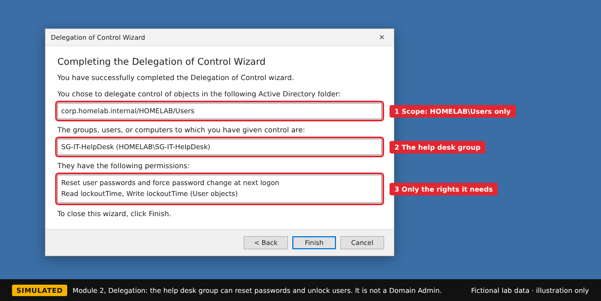

# 02 – OU, Group and Naming Design

## OU structure

Built by [`scripts/01-Build-OUStructure.ps1`](../scripts/01-Build-OUStructure.ps1).

```
corp.homelab.internal
└── HOMELAB                      ← top-level company OU (keeps custom objects out of default containers)
    ├── Users
    │   ├── Finance
    │   ├── HR
    │   ├── IT
    │   ├── Marketing
    │   └── Sales
    ├── Computers
    │   ├── Workstations
    │   └── Laptops
    ├── Groups
    │   ├── Security
    │   └── Distribution
    ├── Service Accounts
    └── Disabled
        ├── Users
        └── Computers
```

**Why this layout?**

- **Department OUs** allow Group Policy and delegated permissions per department (e.g., let HR managers reset HR passwords only).
- **Computers** are kept separate from users because most GPOs target one or the other.
- **Disabled OU**: offboarded accounts are moved here instead of being deleted immediately, so they can be restored if someone was let go by mistake or a manager needs their mailbox.
- **Accidental deletion protection** is on for every OU.

## Naming conventions

| Object | Convention | Example |
| --- | --- | --- |
| Username (sAMAccountName) | first initial + last name, lowercase; add a number if taken | `jcarter`, `jcarter2` |
| UPN | `username@corp.homelab.internal` | `jcarter@corp.homelab.internal` |
| Display name | First Last | Jordan Carter |
| Security group | `SG-<Dept>-<Purpose>` | `SG-Finance-SharedDrive` |
| Distribution group | `DL-<Name>` | `DL-AllStaff` |
| Workstation | `WS-<Dept>-<##>` | `WS-SALES-04` |
| Service account | `svc-<app>` | `svc-backup` |

## Groups

Built by the OU script. The AGDLP model (Accounts → Global groups → Domain Local groups → Permissions) is the long-term goal; this lab uses global security groups per department as the first step.

| Group | Scope | Members | Used for |
| --- | --- | --- | --- |
| SG-Finance-Users | Global | Finance staff | Finance share, Finance GPOs |
| SG-HR-Users | Global | HR staff | HR share |
| SG-IT-Users | Global | IT staff | IT tools |
| SG-Marketing-Users | Global | Marketing staff | Marketing share |
| SG-Sales-Users | Global | Sales staff | Sales share/CRM |
| SG-IT-HelpDesk | Global | Help desk techs | Delegated password-reset rights |
| DL-AllStaff | Global, Distribution | Everyone | Company email list |

## Delegation (least privilege)

Help desk staff should **not** be Domain Admins. In ADUC:

1. Right-click `HOMELAB\Users` → **Delegate Control**
2. Add `SG-IT-HelpDesk`
3. Select **Reset user passwords and force password change at next logon**
4. Add a custom task on User objects: **Read/Write lockoutTime** (allows unlocking accounts)


**What you should see** (simulated screenshot):



📸 Screenshot: Delegation wizard summary → `screenshots/04-delegation.png`
