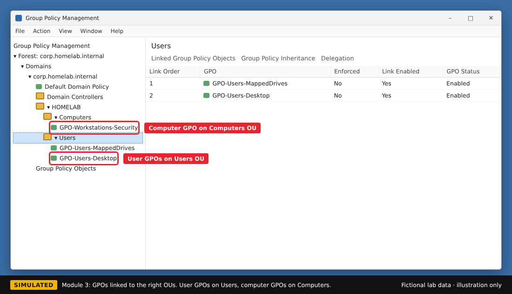
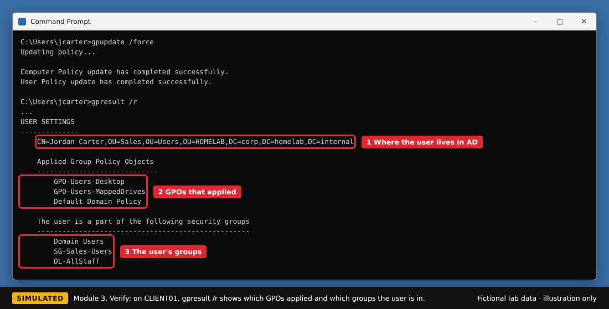

# 03 – Group Policy

Open **Group Policy Management** (`gpmc.msc`) on DC01. For each GPO below: create it, link it where shown, configure it, then verify from CLIENT01.

## GPOs configured

### 1. Default Domain Policy – Password & lockout

Linked to: **domain root** (password policy only works at the domain level unless you use Fine-Grained Password Policies)

`Computer Configuration → Policies → Windows Settings → Security Settings → Account Policies`

| Setting | Value |
| --- | --- |
| Minimum password length | 12 |
| Password must meet complexity requirements | Enabled |
| Enforce password history | 12 |
| Account lockout threshold | 5 invalid attempts |
| Account lockout duration | 15 minutes |
| Reset account lockout counter after | 15 minutes |

**Test:** type a wrong password 5 times on CLIENT01, then on DC01:

```powershell
.\04-Unlock-UserAccount.ps1 -ListLocked
```

### 2. GPO-Users-MappedDrives

Linked to: `HOMELAB\Users`

First create the shares on DC01 (in a real company these would live on a file server, not the DC):

```powershell
New-Item C:\Shares\Shared, C:\Shares\Finance -ItemType Directory
New-SmbShare -Name Shared  -Path C:\Shares\Shared  -ChangeAccess "HOMELAB\Domain Users"
New-SmbShare -Name Finance -Path C:\Shares\Finance -ChangeAccess "HOMELAB\SG-Finance-Users"
```

`User Configuration → Preferences → Windows Settings → Drive Maps`
- `S:` → `\\DC01\Shared` (Action: Update, label "Shared")
- Item-level targeting: `H:` → `\\DC01\Finance` only when the user is in `SG-Finance-Users`

### 3. GPO-Workstations-Security

Linked to: `HOMELAB\Computers`

| Path | Setting | Value |
| --- | --- | --- |
| Computer → Admin Templates → System → Removable Storage Access | All Removable Storage classes: Deny all access | Enabled |
| Computer → Windows Settings → Security Settings → Local Policies → Security Options | Interactive logon: Message title / text | "Authorized use only" banner |
| User → Admin Templates → Control Panel → Personalization | Screen saver timeout / Password protect | 900 sec / Enabled |

### 4. GPO-Users-Desktop

Linked to: `HOMELAB\Users`

- Desktop wallpaper set to `\\DC01\Shared\wallpaper.jpg`
- Prohibit access to Control Panel (applied to all users except IT via **Security Filtering**: remove *Authenticated Users*, add the department groups)

## Verifying and troubleshooting GPOs

On CLIENT01:

```
gpupdate /force                       # pull latest policy now
gpresult /r                           # summary of applied/denied GPOs
gpresult /h C:\Temp\gp.html           # full HTML report
```

| Symptom | Check |
| --- | --- |
| GPO not applying | Is it linked to the OU the **user/computer object** is actually in? (`gpresult /r` → "Applied" vs "Filtered out") |
| User settings not applying | The GPO is linked to a computers OU (or vice versa) |
| Applies to some users only | Security filtering or WMI filter on the GPO |
| Drive map missing | User not in targeted group; log off/on after group change (group membership is in the Kerberos ticket) |


**What you should see** (simulated screenshot):



**What you should see** (simulated screenshot):



📸 Screenshots: `gpresult /r` output and the GPMC tree → `screenshots/05-gpresult.png`, `screenshots/06-gpmc.png`
