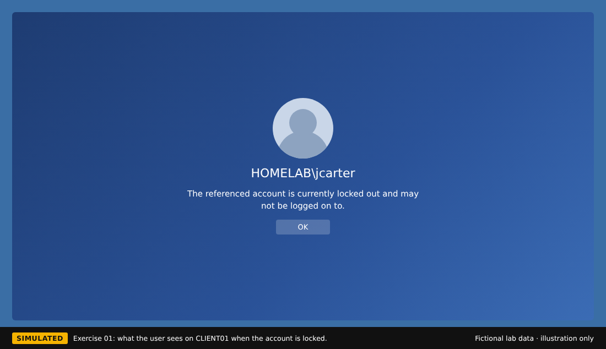

# Exercise 01 – "I keep getting locked out"

## Scenario

> **From:** Jordan Carter (Sales)
> "I'm locked out AGAIN. Third time today. I changed my password yesterday and I'm definitely typing the new one right."

**What the user sees** (simulated screenshot):

## Setup (create the problem)

1. Confirm the lockout policy from Module 3 is in place (5 attempts / 15 minutes).
2. Log in to CLIENT01 as `HOMELAB\jcarter`.
3. Map a network drive to `\\DC01\Shared` and tick **Connect using different credentials**. Enter `HOMELAB\jcarter` with its current password and tick **Remember my credentials**.
4. Sign out. On DC01, reset jcarter's password to something new (use ADUC; don't tick "must change at next logon").
5. Sign in to CLIENT01 as jcarter with the **new** password. Browse to the mapped drive a few times, or sign out and back in, until the account locks.

## Your task

- Confirm the account is locked and how many bad attempts were recorded.
- Find **which computer** the failed attempts are coming from.
- Find **what on that computer** is sending the old password.
- Fix the cause, unlock the account, and confirm it stays unlocked.

## Done when

- [ ] You can name the source computer and the root cause
- [ ] The stale credential is removed and the account is unlocked
- [ ] No new lockout events appear for 15 minutes

Hint 1

`Get-ADUser jcarter -Properties LockedOut, BadLogonCount, LastBadPasswordAttempt`

Hint 2

Lockouts are logged on the DC's Security log. Look up which Event ID means "a user account was locked out". The `-ShowLockoutSource` switch on script 04 will help.

Hint 3

Where does Windows store saved passwords for network resources? Search the Start menu for it.

**Model answer:** [solutions/01-account-lockout.md](../solutions/01-account-lockout.md)
