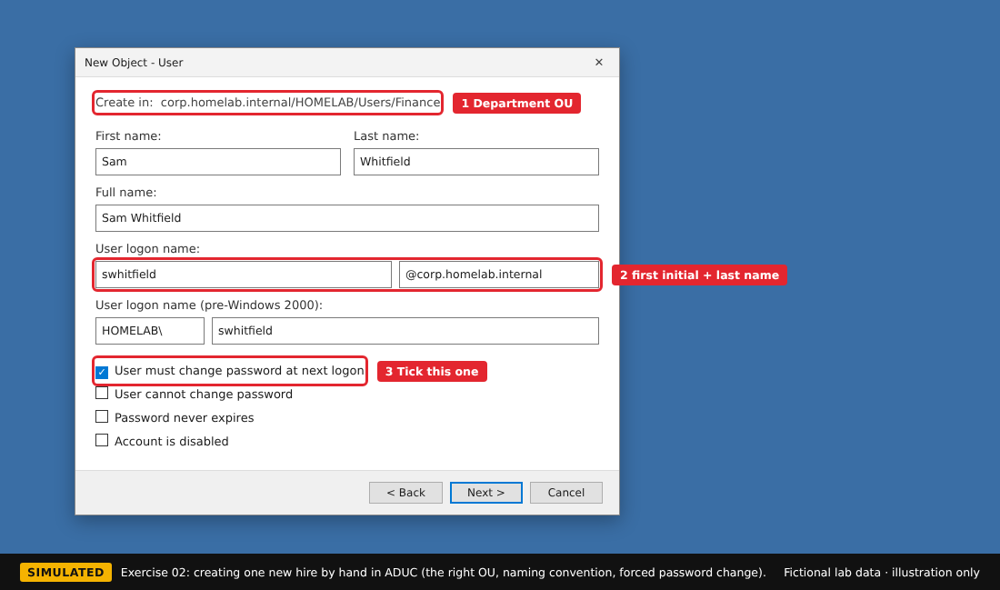

# Exercise 02 – Onboard new starters

## Scenario

> **From:** Morgan Lee (HR)
> "We have three people starting Monday. Can you set up their accounts?
> - Sam Whitfield – Finance – Payroll Specialist – reports to Taylor Patel
> - Priya Desai – Marketing – Graphic Designer – reports to Riley Nguyen
> - Chris Dunn – Sales – Account Executive – reports to Jordan Carter"

## Setup

None. Scripts 01 and 02 should already have run with `data/new-hires.csv`.

## Your task

1. **Before you create anything**, list what you'd confirm with HR or the manager. (What's missing from this request?)
2. Create **one** user by hand in ADUC: right OU, title, department, manager, group membership, "must change password at next logon".
3. Create the other two with `02-New-BulkUsers.ps1` from a new CSV. Run with `-WhatIf` first.
4. Log in to CLIENT01 as one new user and confirm the forced password change.
5. Handle the temporary-password file safely.

**Step 2 in ADUC** (simulated screenshot):

## Done when

- [ ] All three users are in the correct department OU with title, department and manager set
- [ ] Each is in their `SG-<Dept>-Users` group and `DL-AllStaff`
- [ ] You've confirmed a first logon forces a password change
- [ ] The temp-password file is deleted (and was never committed to Git; check `.gitignore`)

Hint

The CSV needs the same columns as `data/new-hires.csv`. The Manager column takes a **username** (e.g. `tpatel`), not a display name.

**Model answer:** [solutions/02-new-hires.md](../solutions/02-new-hires.md)
