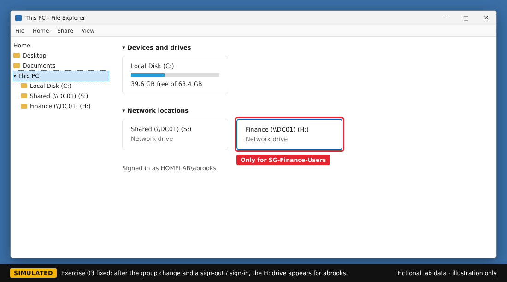

# Exercise 03 – "I can't see the Finance drive"

## Scenario

> **From:** Avery Brooks
> "I transferred from Sales to Finance this week. Everyone on my new team has an H: drive but I don't."
>
> **Approval:** Taylor Patel (Finance manager) has approved Finance share access in the ticket.

## Setup

1. Make sure `GPO-Users-MappedDrives` from Module 3 is in place, with the H: drive targeted to `SG-Finance-Users`.
2. Leave `abrooks` exactly as the bulk script created it (Sales OU, Sales group).

## Your task

- Confirm what's wrong from **both** sides: the user's AD account and the client PC.
- Fix it following **least privilege**. (Should Avery keep Sales access?)
- Update the account so it accurately reflects the new department.
- Get the drive to appear for the user.

## Done when

- [ ] `gpresult /r` on CLIENT01 (as abrooks) shows `SG-Finance-Users`
- [ ] H: drive appears
- [ ] abrooks is no longer in `SG-Sales-Users`, is in the Finance OU, and has Department = Finance

Hint 1

`.\07-Manage-GroupMembership.ps1 -Action Report -Identity abrooks`

Hint 2

You added the group but the drive still isn't there? Think about *when* Windows reads a user's group memberships.

**Model answer:** [solutions/03-shared-drive-access.md](../solutions/03-shared-drive-access.md)

**What done looks like** (simulated screenshot):

