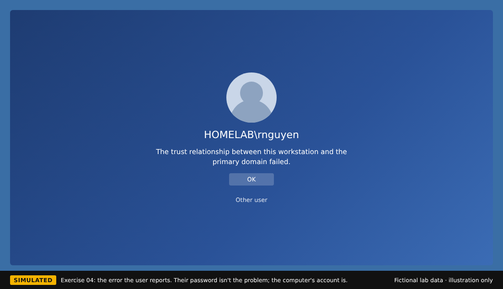

# Exercise 04 – "The trust relationship failed"

## Scenario

> **From:** Riley Nguyen (Marketing)
> "My PC says 'The trust relationship between this workstation and the primary domain failed.' I can't log in at all."

**What the user sees** (simulated screenshot):

## Setup (create the problem)

1. Make sure you know CLIENT01's **local** administrator username and password (you'll need it).
2. On DC01, open ADUC → find CLIENT01 → right-click → **Reset Account**.
3. Restart CLIENT01 and try to log in as `HOMELAB\rnguyen`.

## Your task

- Explain to the "user" in one sentence whether their password is the problem.
- Get into the PC and confirm the diagnosis with a command.
- Repair it **without** removing the PC from the domain.

## Done when

- [ ] You can explain what a computer account password / secure channel is
- [ ] `Test-ComputerSecureChannel` returns `True`
- [ ] rnguyen can log in

Hint

Domain accounts won't work, so log in with `.\Administrator` (the dot means "this computer"). The fix is a single PowerShell cmdlet with a `-Repair` switch.

**Model answer:** [solutions/04-trust-relationship.md](../solutions/04-trust-relationship.md)
