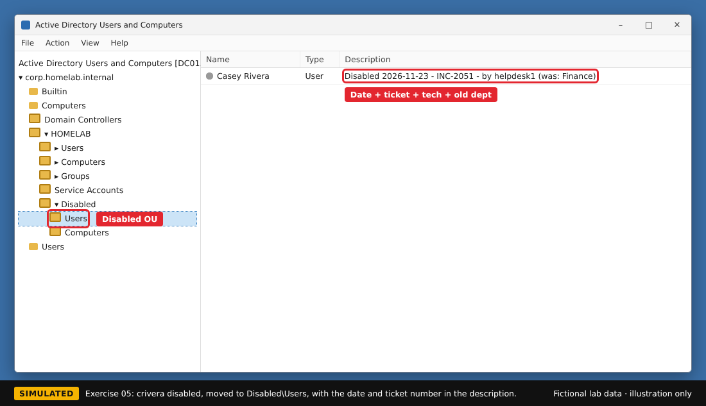

# Exercise 05 – Employee leaving today

## Scenario

> **From:** Drew Kowalski (IT Manager)
> "Casey Rivera in Finance's last day is today. Please remove access at 5pm. HR ticket INC-2051."

## Setup

None. `crivera` was created by the bulk-user script.

## Your task

1. Before doing anything, write down why you'd **disable** rather than **delete** the account.
2. Record what access Casey had (you'll need it if someone asks later).
3. Offboard the account: disable it, remove group access, document why, move it to the Disabled OU. Do it **once by hand** first, then reset (from snapshot) and do it with `05-Disable-OffboardUser.ps1 -WhatIf` followed by the real run.
4. Prove Casey can no longer sign in.

## Done when

- [ ] Account disabled and in `HOMELAB\Disabled\Users`
- [ ] Only member of Domain Users
- [ ] Description shows date + ticket number
- [ ] A CSV of the old group memberships exists
- [ ] Sign-in as crivera on CLIENT01 fails with an "account disabled" message

**Model answer:** [solutions/05-offboarding.md](../solutions/05-offboarding.md)

**What done looks like** (simulated screenshot):

