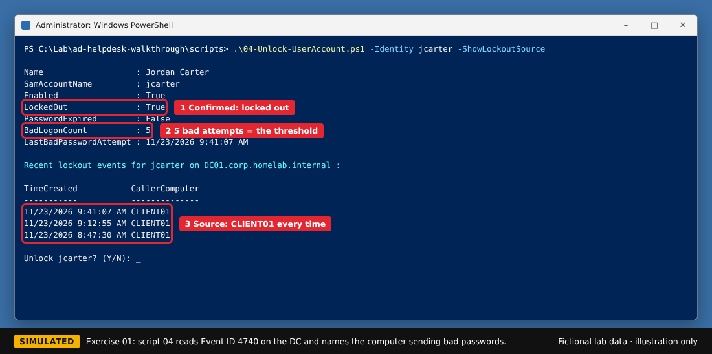
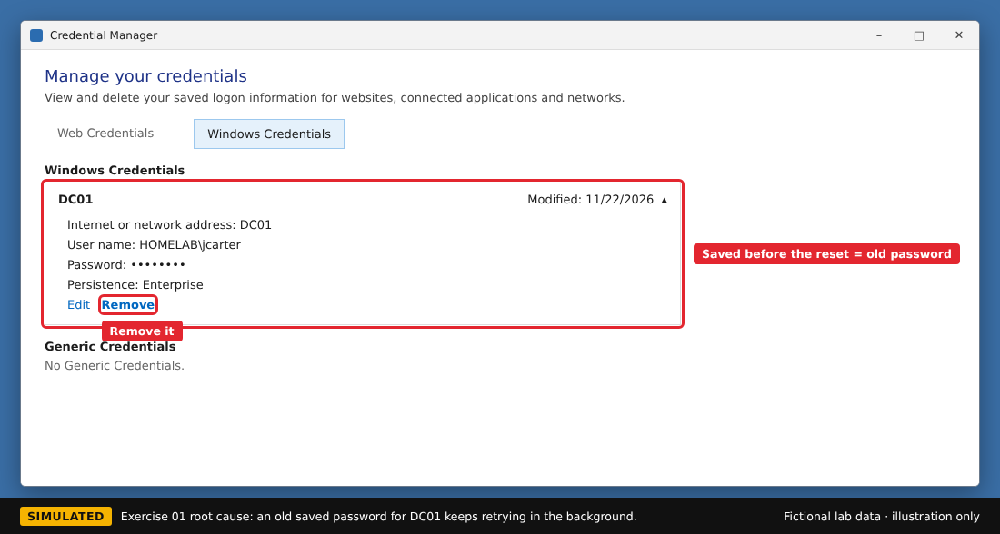

# Solution 01 – Repeated account lockout

## Troubleshooting

1. **Verify identity.** In a real job: call back the number on file or follow company policy before touching the account.
2. **Confirm the lockout:**

```powershell
   Get-ADUser jcarter -Properties LockedOut, BadLogonCount, LastBadPasswordAttempt |
       Select-Object SamAccountName, LockedOut, BadLogonCount, LastBadPasswordAttempt
```

*Example output:*

```
   SamAccountName LockedOut BadLogonCount LastBadPasswordAttempt
   -------------- --------- ------------- ----------------------
   jcarter             True             5 11/23/2026 2:14:07 PM
```

3. **Find the source computer.** Event ID **4740** (account locked out) is logged on the PDC Emulator:

```powershell
   .\04-Unlock-UserAccount.ps1 -Identity jcarter -ShowLockoutSource
```

The `CallerComputer` column shows **CLIENT01**.
4. **Ask the user** about recent changes. Password changed yesterday, so something still has the old one.
5. **Check CLIENT01** → *Credential Manager* → *Windows Credentials*. There's a saved entry for `DC01` / `\\DC01\Shared` with the old password.

**What you should see** (simulated screenshot):




## Root cause

A credential saved with the old password in Credential Manager kept authenticating to the file share, hitting the 5-attempt lockout threshold.

**What you should see** (simulated screenshot):




## Resolution

1. Removed the stale entry from Credential Manager (or `cmdkey /list` then `cmdkey /delete:DC01`).
2. Unlocked: `.\04-Unlock-UserAccount.ps1 -Identity jcarter`
3. Remapped the drive without saved alternate credentials.

## Verification

After 15 minutes, `BadLogonCount` is 0 and no new 4740 events appear for jcarter.

## Teaching points

- **Unlocking alone doesn't fix this.** It relocks within minutes. Always find the source.
- Other common sources in real life: phone email apps, saved RDP connections, scheduled tasks or services running as the user, a second PC still logged in.
- Advise users to update saved passwords everywhere after a change.
