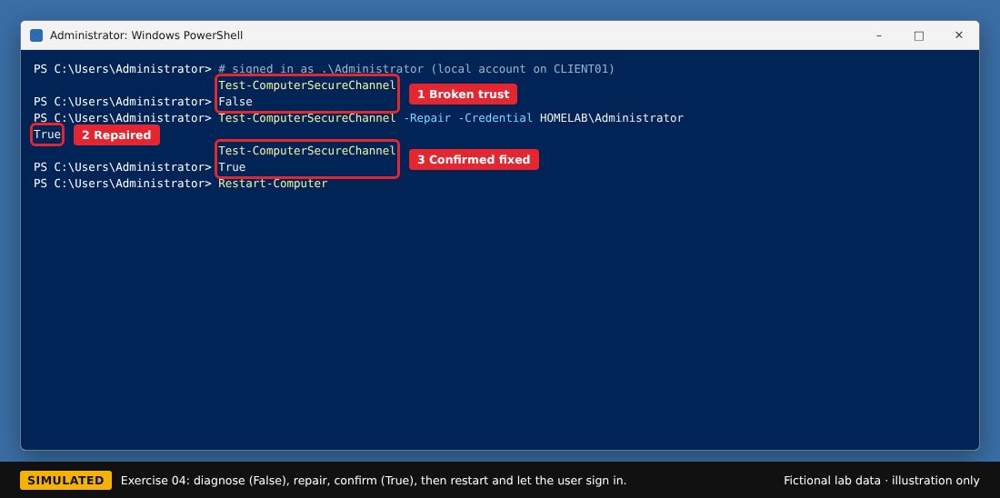

# Solution 04 – Trust relationship failed

## What to tell the user

"This isn't your password. The computer itself has lost its connection to the domain. I'll fix it and you'll be able to log in normally."

## Background

Every domain-joined computer has its own account in AD with a password it changes automatically (every 30 days by default). The PC and AD must agree on that password to set up a **secure channel**. If they don't (account reset in AD, or a PC restored from an old image/snapshot), domain logons fail with this error.

## Troubleshooting

1. Log in to CLIENT01 as the local admin: `.\Administrator`
2. Elevated PowerShell:

```powershell
   Test-ComputerSecureChannel
```

*Example output:* `False`

## Resolution

```powershell
Test-ComputerSecureChannel -Repair -Credential HOMELAB\Administrator
Restart-Computer
```

(Alternatives: `Reset-ComputerMachinePassword -Credential ...`, or as a last resort remove from domain → workgroup → rejoin.)

**What you should see** (simulated screenshot):




## Verification

`Test-ComputerSecureChannel` returns `True`; rnguyen logs in successfully.

## Teaching points

- Repairing keeps the computer's AD object, so its OU, group memberships and GPO targeting all stay intact. Rejoining can lose them.
- Every PC needs a known local admin account for exactly this situation (in real companies, managed with **Windows LAPS**).
